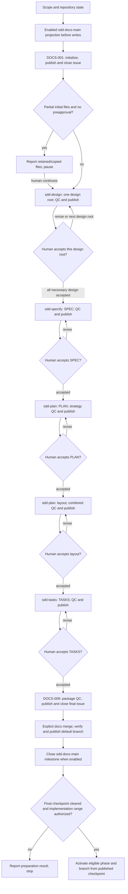
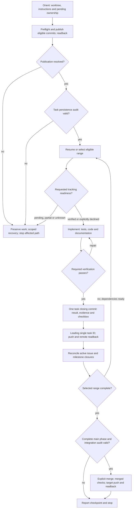
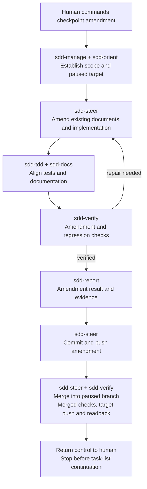
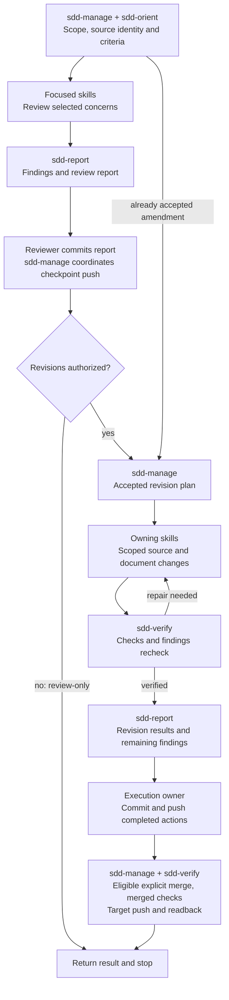

# SDD Manager

**Develop from explicit requirements, implement in bounded steps, and keep the human in control.**

SDD Manager is a learning-by-doing experiment in specification-driven development with coding agents, packaged as an Agent Plugin for Git repositories. It composes focused skills into workflows for exploration, design, specification, planning, implementation, verification and releases. Practical project runs inform its refinement; local source checks and live agent/client acceptance have distinct evidence boundaries.

In the source repository, the complete plugin package is at `.agents/plugins/sdd-manager/`, available for agents to load when working on SDD Manager itself. A separate agent installation remains an option. This checkout layout does not configure automatic loading; installed or extracted packages begin at their own plugin root.

The agent entry is [PLUGIN.md](PLUGIN.md). Start with **sdd-manage** for coordinated work; it routes requests, reuses established decisions and honors your stopping boundary. PLUGIN.md describes how the skills work together, while each SKILL.md and its selected references own detailed instructions. Load an available entry explicitly when needed; if it is unavailable, use the coordinator and skill entries directly. Automatic loading is client-dependent.

Development uses [SDD Manager](assets/SDD-MANAGER.md). See the [AI-assisted development disclosure](assets/AI_DISCLOSURE.md).

## Getting started

Load the package using your agent client's supported plugin mechanism. Project changes require an existing eligible Git worktree, access to its files and tools, and respect for its controlling instructions. Repository initialization is outside the plugin's scope. Checks use the target project's declared tools.

For a new project, copy the [Greenfield Project Prompt Template](<assets/Greenfield Project Prompt Template.md>) and replace its project, repository and token placeholders. The [Tetris demo](https://github.com/pchemguy/SDD-Manager/blob/main/docs/demo/tetris/README.md) illustrates phased delivery and feature expansion; the [Calculator demo](https://github.com/pchemguy/SDD-Manager/blob/main/docs/demo/calculator/README.md) proposes a simpler phase/feature sequence.

Give the coordinator an objective and stopping point:

```text
Use sdd-manage to inspect this repository and prepare its development
specification, plan, layout and task list. Use the attached brief as input.
Stop before implementation.
```

Once the required documents are accepted:

```text
Use sdd-manage to implement milestone 1.1 from TASKS.md.
Verify, commit and push each completed task. If its phase is incomplete,
pause without merging. Integrate only an eligible complete boundary.
```

Use your actual task/milestone IDs. You can enter a later stage when its inputs are established. Fresh/resumed main preparation starts with the [tracked documentation procedure](skills/sdd-manage/references/main-preparation.md) below. Other adoption follows [repository bootstrap](skills/sdd-manage/references/repository-bootstrap.md).

Hosting is optional for local work. Use existing shell/API authentication; credential failures follow [credential recovery](skills/sdd-manage/references/credentials.md), using ignored protected token storage. Git and API access are separate. The [GitHub backend](skills/sdd-forge/references/github.md) defines the scoped permission profile; Actions access is conditional on requested workflow operations. Supplying credentials does not accept documents or widen the work scope.

For eligible completed GitHub implementation task/milestone reconciliation, the optional [completion utility](skills/sdd-forge/scripts/forge-close.md) provides bounded lookup, evidence reconciliation, closure and readback. It requires Node 22+, Git and protected local input; workflow owners retain actual acceptance/publication gates. Other SDD workflows do not require Node.

For selected GitHub phase or main-preparation projection, the optional [projection utility](skills/sdd-forge/scripts/forge-project.md) accepts explicit reviewed JSON. Its [local draft/input workflow](skills/sdd-forge/scripts/forge-project-input.md) extracts phase task structure for agent-authored dependencies/briefs, or binds complete predefined documentation content. It previews outgoing content, creates/reuses exact objects and verifies associations; the coordinator retains eligibility decisions. The same optional Node/Git requirements apply.

## Core development workflows

At workflow startup the agent identifies the actual execution OS and checks shell readiness on Windows. If a tool's PowerShell launcher fails, the [Windows recovery workflow](skills/sdd-manage/references/windows-shell-recovery.md) can deploy the supplied CMD adapter for a compatible invocation, then retry. Successful activation is reported with the reminder that every single quote becomes a double quote; a failed retry is reported and ends the turn. The probe applies across Windows clients, including local Codex; actual launcher compatibility is checked rather than inferred from the client name.

| Workflow | Purpose and typical path |
| --- | --- |
| **Main development** | Define the complete system, then implement it in bounded increments from design, SPEC, PLAN/layout, and TASKS. Existing projects can enter at an established stage. |
| **Revision** | Correct, simplify, or improve defined/implemented work, typically through the retained review/revision process. A focused accepted prompt can supply the revision objective directly. |
| **Feature** | Add a scoped capability through the necessary feature document package and FEATURE-TASKS, then implement and incorporate accepted deltas within the authorized boundary. |

**Steering is a lightweight revision path** at a paused implementation checkpoint. You command a focused amendment; the agent updates existing documents, code, tests, and documentation without feature overlays or an obligatory formal campaign. It verifies and integrates into the paused branch, then returns control so you decide when to resume.

The [canonical workflow model](skills/sdd-manage/references/workflows.md#core-development-workflows) defines entry and scope; the operations below are stages or supporting work, rather than additional core workflows.

## Operations

| Objective | Example request | Result |
| --- | --- | --- |
| Read a workflow before development | “Explain the greenfield workflow and its approval checkpoints; do not start development.” | Sources read, applicable stages/checkpoints, scope and next step in chat; no project changes. |
| Explore and prepare a project | “Compare approaches, then prepare the project through TASKS.” | Accepted design, behavior, delivery strategy, physical ownership, and executable tasks. |
| Prepare a feature | “Define ZIP support and its feature task list.” | Scoped requirements and the necessary feature design, plan, and tasks. |
| Implement a range | “Implement the next three tasks and stop.” | Verified task commits on the phase/feature branch; incomplete phases pause, while eligible complete boundaries explicitly integrate and publish. |
| Resume interrupted work | “Resume milestone 2.2 without discarding pending work.” | Existing work inspected and continued before new tasks are selected. |
| Amend at a checkpoint | “Remove encrypted streams from the implemented scope, including tests and documentation.” | Verified amendment explicitly merged into the paused implementation branch, published, then control returned to the human. |
| Integrate an accepted feature | “Incorporate FEATURE-SPEC into SPEC only.” | Selected main documents reconciled without unrelated task-list changes. |
| Review and revise a project | “Plan a systematic review,” “Review this protocol,” or “Implement accepted findings.” | Retained campaign plans/reports, stable findings, and authorized verified revisions incorporated into governing documents. |
| Review or maintain a scope | “Review PLAN,” “Verify this phase,” or “Align README.” | Findings, evidence, or the explicitly requested maintenance. |
| Review a release candidate | “Run a comprehensive prerelease review of this candidate.” | Complete current-product coverage, candidate-specific findings and readiness; published report, with repairs and release kept within separately authorized scope. |
| Prepare a release message | “Prepare release message,” “Draft release notes,” or “Update the release notes.” | Complete Markdown at root `RELEASE-NOTES.md`: curated Git changes plus applicable overview, compatibility, installation and limitation sections; retained and atomically refreshed, without publication. |
| Collect release highlights | “Summarize key changes since the latest release; update the draft incrementally.” | Provider-independent Git range, curated ignored YAML checkpoint and highlights only; no hosting access or publication required. |
| Prepare release packaging | “Verify this ZIP and prepare a workflow that builds it.” | Assessed package contents, stable asset names, build/checksum procedure and verified workflow preparation; interactive development when needed. |
| Create a GitHub release | “Create release v1.2.3 from the verified commit using the configured packages.” | One publisher, complete assets, release state/readback and applicable stable download URLs; actual CI/download verification limits. |
| Synchronize GitHub tracking | “Create issues and milestones for these tasks.” | Phase labels, milestones, task issues, and verified task associations. |

Preparation and review stop before implementation unless your request includes it. Steering finishes the amendment and returns control to you; you separately decide when to resume the task list. Transferring feature tasks into the main task list requires both lists in scope so each task retains one executable owner.

Choose a [reporting profile](skills/sdd-manage/references/coordination.md#reporting-profiles) in your initial prompt or switch during work. Profiles change presentation, while scope checks, approval gates, verification and publication remain the same.

| Profile | What to expect |
| --- | --- |
| **Minimal** | Brief scope changes, results, blockers and required decisions; little routine narration |
| **Standard** (default) | Concise scope briefs, useful progress and rationale for consequential decisions |
| **Explicit** | Clearly identified scope/checkpoints, fuller rationale, relevant sources and verification evidence |

For example: “Use SDD Manager with minimal reporting,” “Switch to explicit reporting,” or “Return to standard reporting.” The selection continues through the current conversation/workflow and handoffs while context is available. “Explain this decision fully, then resume minimal reporting” overrides one response. None of the profiles requires repeating unchanged context every response. At composite-workflow entry, material switching or context recovery, the agent uses Explicit reporting, announces it and briefly explains the three choices. Before dependent work it declares the following level: Standard by default, or your established selection. This introduction does not repeat during routine continuation.

For detailed entry conditions and stopping rules, see the [workflow catalog](skills/sdd-manage/references/workflows.md).

## Project documents and checkpoints

The main documents describe the complete intended project. Roots may link to focused children; executable work is derived only after the required inputs are ready.

| Document under `docs/dev/` | Owns |
| --- | --- |
| `PROJECT.md` | Concise project brief: purpose, users, outcomes, principal scope/non-goals and consequential constraints. |
| `ARCHITECTURE.md` | Major blocks, relationships, dependency direction, and design decisions. |
| `DECOMPOSITION.md` | Component responsibilities, collaborations, and design-level interfaces. |
| `SPEC.md` | Required behavior, final contracts, errors, invariants, and acceptance. |
| `PLAN.md` | Meaningful end-to-end MVP, small capability increments, phases/milestones, dependencies, and verification/decision gates. |
| `layout.md` | Physical ownership of source, tests, documentation, and other artifacts. |
| `TASKS.md` | Phase → Milestone → Task hierarchy, stable IDs, and progress evidence. |
| `DOCS_TASKS.md` | Predefined main preparation: initialization, seven document first approvals and final package QC. |
| `DOCS-QC-REPORT.md` | Whole documentation package readiness, checked sources, findings and evidence limits. |
| `HANDOFF.md` | Workflow checkpoint, authorized scope/stop, branches/parent return and pending work; later records and Git supply subsequent changes. |

PROJECT.md turns the seed and clarified decisions into shared project context, with material assumptions/questions identified. Its [authoring contract](skills/sdd-design/references/project-brief.md) defines adaptable content and the boundary with design/SPEC.

### Human review

Greenfield preparation walks you through PROJECT, ARCHITECTURE, DECOMPOSITION, SPEC, PLAN, layout and TASKS. Each necessary newly created document gets substantive analysis and its own human acceptance checkpoint before dependent work; PLAN and layout remain separate. Clarification answers, agent QC and standing Git authorization do not accept documents.

Existing or interrupted preparation assesses actual progress and continues using acceptable inputs. Requested interactive reviews come first; important startup issues can prompt concerns. Feature preparation reviews only necessary deltas and reuses sufficient main inputs. See [human document review](skills/sdd-manage/references/human-document-review.md).

You may **preapprove future human checkpoints at any time**, individually or as a scoped set—for example, “Preapprove the remaining document checkpoints; stop before implementation.” The agent still reports each result and performs required QC, commits, pushes and tracking operations. Preapproval does not expand your implementation range.

### Main preparation tracking

The generated AGENTS.md enables GitHub tracking for documentation preparation and implementation by default. When initialization will install this template, the coordinator resolves its default before the first repository write. Explicit choices and existing project policy take precedence; copying the file does not reset them. You can change this project-level policy by instructing the agent or editing AGENTS.md, including choosing local-only work.

When enabled, tracking creates/verifies the native `sdd-docs-main` milestone and all nine preparation issues **before repository modifications**. The [bundled JSON](assets/DOCS_TRACKING_TEMPLATE.json) fixes the milestone title/plain-text description and complete issue briefs/dependencies. Initialization preserves existing root AGENTS/disclosure/usage/discovery files and copies missing ones. If only some existed, the agent reports both groups and pauses after publishing initialization; none/all present adds no approval stop. Existing preparation resumes without replacing files or replaying first approvals.

`docs/dev/DOCS_TASKS.md` comes from the bundled template. Each document task completes at first approval: its approved state and checked task share one commit, followed by push/readback and issue closure. Later document revisions keep that task complete and issue closed. The last task/issue checks the whole package; then the docs branch merges, the verified merge is published, the milestone closes and the agent confirms the final checkpoint before implementation. See [main preparation](skills/sdd-manage/references/main-preparation.md).

### Agent quality checks

SPEC is checked against accepted PROJECT/design; PLAN/layout against SPEC; TASKS against PLAN before execution or hosted projection. Adjacent QC reports retain findings and rechecks; unresolved confirmed blockers stop dependent work. See [document quality gates](skills/sdd-manage/references/document-qc-gates.md) and [shared QC policy](skills/sdd-conventions/references/development-document-qc.md) for reports, decomposition and task-sizing guidance.

PLAN begins with a meaningful end-to-end MVP and grows through small testable increments. Feature documents use FEATURE_ARCHITECTURE.md, FEATURE_DECOMPOSITION.md, FEATURE-SPEC.md, FEATURE-PLAN.md and FEATURE-TASKS.md as needed; accepted deltas are incorporated through sdd-integrate-feature. Steering directly amends existing documents.

## Continue with another agent

The agent follows the project's AGENTS.md to `docs/dev/HANDOFF.md`, then recovers later work and decisions from development records and Git. Handoffs are created at workflow entry and refreshed automatically by milestone/phase review tasks, revision finalization and parent return; ordinary task commits need no handoff rewrite.

Each workflow branch keeps its own copy until integration into its recorded creation parent. Starting on default with unfinished branches, the agent presents candidates and asks which to continue unless you already selected one. Returning from a child restores the parent's scope and pending human checkpoint; it does not start more tasks automatically.

You can request “prepare a handoff” for an additional transfer check, but it is not required for normal continuation. Publish the selected branch and make the required plugin/tools available to the receiving agent; an ordinary clone cannot supply unpublished or ignored files, credentials or unavailable capabilities. See [continuity](skills/sdd-manage/references/continuity.md) for the protocol.

## Workflow guide

These diagrams explain the human-visible paths. [PLUGIN.md](PLUGIN.md#composite-workflows) summarizes agent selection, handoffs and operational boundaries. Enter at the stage supported by current inputs; a blocker preserves work and stops the affected path.

### Project preparation

Each authoring node below creates/checks and publishes one necessary proposal before human review (or follows explicit preapproval). First approval is then recorded with the completed DOCS task in its published acceptance commit, followed by issue closure when enabled. Design repeats this checkpoint for PROJECT, ARCHITECTURE and DECOMPOSITION; PLAN and layout have separate checkpoints. Dependent implementation starts only after accepted preparation is integrated, verified and published to the actual default branch.



See [the owning workflow](skills/sdd-manage/references/branch-management.md#preparation-integration-gate).

### Implementation and continuation

Implementation inspects retained commits for publication eligibility, publishes verified eligible work, then resumes the selected range. A known-invalid completion enters bounded recovery before publication. Forward repairs within established authority do not require blanket reapproval; historical commit-composition exceptions remain human decisions. Each task closes with its result, evidence and checklist together. Requested tracking must be ready; a partial main-phase range publishes and pauses, while a complete eligible boundary integrates.



See [the owning workflow](skills/sdd-implement/SKILL.md).

### Checkpoint steering

You command an amendment at a paused implementation checkpoint. It updates existing documents, implementation and tests, integrates into the paused branch, then returns control. Assessment-only requests stop at impact; successful steering does not resume the task list.



See [the owning workflow](skills/sdd-steer/SKILL.md).

### Review and revision

Review produces findings; source changes require revision authorization. An accepted amendment can enter revision planning directly. Formal campaigns retain plans/reports; nested revisions and eligible reopened amendments keep their established source and return context.



See [the owning workflow](skills/sdd-manage/references/review-and-revision.md).

## Release operations

### Highlights and release messages

“Collect release highlights” produces curated Git changes only. “Prepare release message” assembles a complete message at root RELEASE-NOTES.md, adding applicable overview, compatibility, installation and limitation sections. Subsequent preparation refreshes coverage and preserves applicable human edits; the file remains until refreshed again. Explicit templates/paths and supplied-text-only editing retain their narrower scope.

A release request checks local source coverage and the stated version; a matching version alone does not prove freshness. The finalized complete Markdown body is shared by the release commit and GitHub message, and the release tag points to that verified commit. See [release-message preparation](skills/sdd-forge/references/release-message.md) and the narrower [Git highlights workflow](skills/sdd-forge/references/release-highlights.md).

### Packaging and publication

Preparing a package/workflow does not publish a release. Publication uses verified local packages or an existing workflow, complete assets and provider readback; it does not require task tracking. Asset names are version-free, such as project.zip, while tags/metadata identify the version. Stable downloads use https://github.com/{OWNER}/{REPO}/releases/latest/download/{ASSET_NAME} and require the complete advertised latest-stable asset set.

See [packaging](skills/sdd-forge/references/github-packaging.md), [release workflows](skills/sdd-forge/references/github-release-workflows.md), [release creation](skills/sdd-forge/references/github-releases.md) and [verification](skills/sdd-verify/references/release-checks.md). An explicitly selected [comprehensive prerelease review](skills/sdd-manage/references/prerelease-review.md) provides candidate findings/readiness; its advisory reminder does not make that review mandatory for a release.

## Plugin package

The Agent Plugins 1.0 package includes package-root plugin.json, README.md, PLUGIN.md and LICENSE, plus skills/ and assets/. Assets include disclosure/usage notices, [AGENTS_TEMPLATE.md](assets/AGENTS_TEMPLATE.md), [DOCS_TASKS_TEMPLATE.md](assets/DOCS_TASKS_TEMPLATE.md), [DOCS_TRACKING_TEMPLATE.json](assets/DOCS_TRACKING_TEMPLATE.json), [SKILL_DISCOVERY_PROTOCOL.md](assets/SKILL_DISCOVERY_PROTOCOL.md) and the [Greenfield Project Prompt Template](<assets/Greenfield Project Prompt Template.md>). Root plugin.json is the sole manifest; OpenAI presentation metadata is under extensions.com.openai.interface. PLUGIN.md is SDD Manager's explicit composition entry, not a claim of standardized automatic discovery.

All 15 skills are distributed together. Their relative references stay within the plugin root; named handoffs and client loading/routing are separate concerns. See [bundled-skill guidance](https://github.com/pchemguy/SDD-Manager/blob/main/docs/dev/CAPABILITY-MAP.md#bundled-skill-references). Artwork includes assets/icon.svg, icon.png, logo.svg and logo.png; manifest icons use icon.svg and logo.svg, including dark variants.

Source acceptance/development/CI files are excluded from the archive; links to them use repository URLs. The source repository retains a development-only root AGENTS.md outside the package. Projects using the plugin retain their own AGENTS.md instructions.

## Skills

The [skill routing table](PLUGIN.md#skill-routing) links all 15 owners. sdd-manage coordinates; sdd-orient and sdd-conventions establish shared context/criteria. Design, specification, planning and tasks have separate owners; implementation, steering and feature incorporation own execution changes. Testing, verification, documentation, reporting and hosting/release skills supply focused supporting work.

## Status and evidence

All 15 skills are included. Structural/local verification and fresh-agent workflows through explicit skill-source loading have been exercised. Historical independent acceptance covered 27 scoped cases; the current TextStats catalog supports 33 cases, including release-message and optional client scenarios. Added coverage does not inherit historical passes. Revised-source live acceptance and installed-client discovery/routing/activation remain separate evidence gaps; retained journals are not complete native transcripts.

See the [TextStats overview and qualified historical evidence](https://github.com/pchemguy/SDD-Manager/blob/main/acceptance/TEXTSTATS.md) and source campaign records for exact tested versions and limitations. Static schema/package checks do not establish client compatibility.

## Testing and contributing

Source contributors explicitly load [acceptance/AGENTS.md](https://github.com/pchemguy/SDD-Manager/blob/main/acceptance/AGENTS.md) before work on SDD Manager, including work outside acceptance/. It owns verification commands, publisher dependencies and acceptance routing. [Testing with TextStats](https://github.com/pchemguy/SDD-Manager/blob/main/acceptance/TEXTSTATS.md) introduces the dedicated test project and its coordinator entry.

## References

- [Agent entry and composition](PLUGIN.md): routing, workflow handoffs and work boundaries.
- [Capability map](https://github.com/pchemguy/SDD-Manager/blob/main/docs/dev/CAPABILITY-MAP.md): detailed ownership and package/reference guidance.
- [Review campaigns](https://github.com/pchemguy/SDD-Manager/blob/main/docs/dev/reviews/README.md): retained findings, revisions and exact verification provenance.
- [Nested revisions and campaign amendments](skills/sdd-manage/references/revision-modes.md): parent suspension, eligible reopening and return boundaries.
- [TDD provenance](skills/sdd-tdd/references/upstream-provenance.md): adaptation of Superpowers TDD and its retained MIT license.

## License

SDD Manager is licensed under the [MIT License](LICENSE). Bundled third-party material retains its own license and attribution, including [the TDD adaptation license](skills/sdd-tdd/LICENSE).

## Related projects

[GitHub Spec Kit](https://github.com/github/spec-kit) provides structured workflows and reusable assets for coding agents. [Superpowers](https://github.com/obra/superpowers) presents a development methodology built from composable skills. These are related reading for users exploring agent-assisted development; they are not dependencies, endorsements or claims of derivation.
